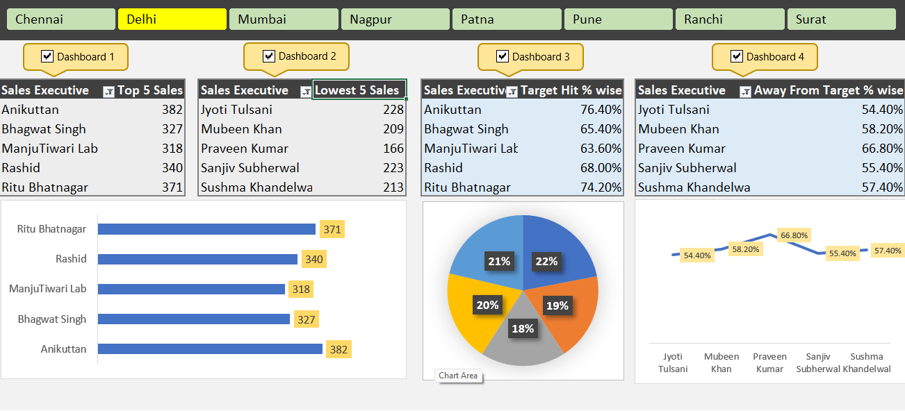
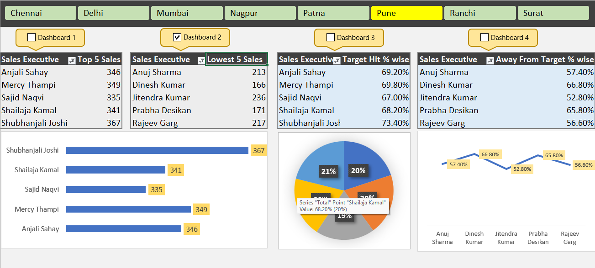
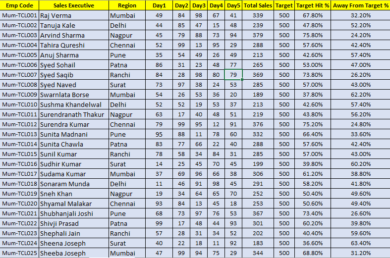
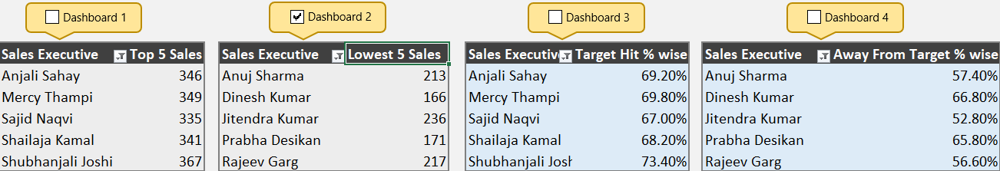

# Excel-Sales-Performance-Dashboard
Interactive Excel Sales Performance Dashboard built using PivotTables, PivotCharts, Region Slicers, Form Control Checkboxes, Recorded Macros, and VBA automation to dynamically manage slicer connections across multiple PivotTables.

---

# 📊 Excel Sales Performance Dashboard | Interactive Dashboard & VBA Automation

An interactive **Sales Performance Dashboard built using Microsoft Excel**, designed to analyze sales executive performance, compare sales against targets, and explore regional performance through dynamic visualizations.

The project combines Excel's data analysis and visualization capabilities with **PivotTables, PivotCharts, Slicers, Form Control Checkboxes, Macros, and custom VBA automation** to create a flexible and interactive reporting experience.

---

## 📸 Dashboard Preview

### Main Dashboard





---

## 🎯 Project Overview

The objective of this project is to transform raw sales data into an interactive dashboard that makes it easier to monitor sales performance and identify patterns across different regions.

The dashboard analyzes sales executives' daily sales, total sales, target achievement percentages, and performance gaps.

One of the key features is a **custom VBA-based slicer connection controller**. It allows users to select which PivotTables should respond to the Region slicer using Form Control Checkboxes.

This provides greater flexibility and control over dashboard interactions.

---

## ✨ Key Features

### 1. Interactive Sales Dashboard
- Visual representation of sales performance.
- Analysis of sales executives based on total sales.
- Comparison of target achievement and performance gaps.
- Multiple PivotCharts for better data visualization.

### 2. PivotTables & PivotCharts
- 4 PivotTables for organizing and summarizing sales information.
- 3 PivotCharts, including:
  - Bar Chart
  - Pie Chart
  - Line Chart
- Dynamic analysis using PivotTable-based visualizations.

### 3. Interactive Region Slicer
- Region-based filtering.
- Allows users to explore sales performance across different regions.
- Provides an interactive way to analyze the underlying data.

### 4. Form Control Checkboxes
- Implemented Excel Form Control Checkboxes.
- Each checkbox is linked to a specific cell.
- Allows users to select which PivotTables should respond to the Region slicer.

### 5. VBA Automation
- Used Excel's Record Macro feature.
- Developed custom VBA code to automate checkbox functionality.
- Dynamically connects or disconnects PivotTables from the Region slicer based on checkbox selections.
- Provides flexible control over dashboard filtering without manually changing slicer connections.

---

## 🛠️ Tools & Technologies

| Tool / Feature | Purpose |
|---|---|
| Microsoft Excel | Data analysis and dashboard development |
| PivotTables | Data summarization and analysis |
| PivotCharts | Interactive data visualization |
| Slicers | Dynamic data filtering |
| Form Control Checkboxes | User-controlled selection |
| Excel Macros | Task automation |
| VBA (Visual Basic for Applications) | Custom dashboard automation |

---

## 📂 Dataset Overview

The workbook contains a raw sales dataset with **141 sales executives across 8 regions**.

The dataset includes the following columns:

| Column | Description |
|---|---|
| Emp Code | Unique employee code |
| Sales Executive | Name of the sales executive |
| Region | Sales location |
| Day1 – Day5 | Daily sales figures |
| Total Sales | Total sales generated over five days |
| Target | Assigned sales target |
| Target Hit % | Percentage of the sales target achieved |
| Away From Target % | Percentage remaining to achieve the target |

### Data Preview



---

## 📊 PivotTables & Analysis

The project uses four PivotTables to summarize sales information and support dashboard visualizations.



These PivotTables provide the underlying summarized data used by the dashboard charts and performance comparisons.

---

## 🎛️ Slicer & VBA Automation

### Region Slicer

The Region slicer allows users to filter sales information based on different regions.


### Custom VBA Functionality

A key part of this project is controlling PivotTable slicer connections through Form Control Checkboxes.

**How it works:**

1. Each checkbox is linked to a designated worksheet cell.
2. When a user selects or deselects a checkbox, its linked cell value changes.
3. VBA code reads the checkbox-linked values.
4. Based on the selections, the VBA code connects or disconnects the corresponding PivotTable from the Region slicer.
5. The user can decide which PivotTables respond to slicer selections.

This functionality makes the dashboard more flexible and demonstrates practical Excel VBA automation.

---

## 📁 Project Structure

```text
Excel-Sales-Performance-Dashboard/
│
├── Excel-Sales-Performance-Dashboard.xlsm
│
├── images/
│   ├── Dashboard_Main.png
│   ├── Dashboard_Overview.png
│   ├── DataPreview.png
│   ├── PivotTable_Analysis.png
│   └── Region_Slicer.png
│
└── README.md
```

---

## 🚀 How to Use the Project

1. Clone or download this repository.
2. Open the `.xlsm` workbook using Microsoft Excel Desktop.
3. Enable macros if you trust the workbook and its VBA code.
4. Navigate to the **DASHBOARD** worksheet.
5. Use the Region slicer to filter the sales data.
6. Select or deselect the Form Control Checkboxes to control which PivotTables respond to the slicer.
7. Explore the charts and summarized sales performance.

**Note:** This project uses VBA automation and Form Control Checkboxes. For full functionality, use the desktop version of Microsoft Excel with macros enabled. Excel for the web does not execute VBA macros.

---

## 💡 What I Learned

Through this project, I gained practical experience in:

- Working with and analyzing raw sales datasets in Excel.
- Creating and managing multiple PivotTables.
- Building interactive dashboards using PivotCharts and Slicers.
- Using Form Control Checkboxes for user interaction.
- Recording macros and writing custom VBA code.
- Automating PivotTable slicer connections.
- Combining data analysis, visualization, and automation into one Excel solution.

---

## 👨‍💻 Author

**Mohd Zaid**

Aspiring Data Analyst | Excel | SQL | Python | Power BI

- **GitHub:** [mohd-zaid11](https://github.com/mohd-zaid11)
- **LinkedIn:** [Mohd Zaid](https://www.linkedin.com/in/mohd-zaid-bin-haneef-09b99126a/)

---

⭐ If you find this project interesting, feel free to explore the repository and share your feedback!
